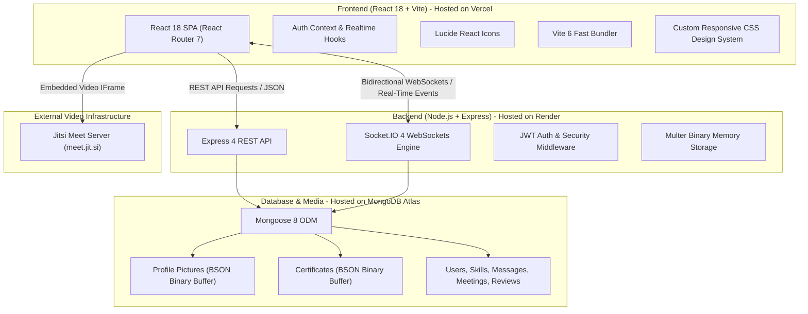
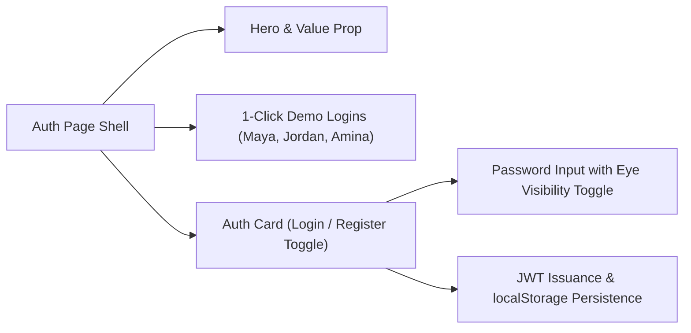
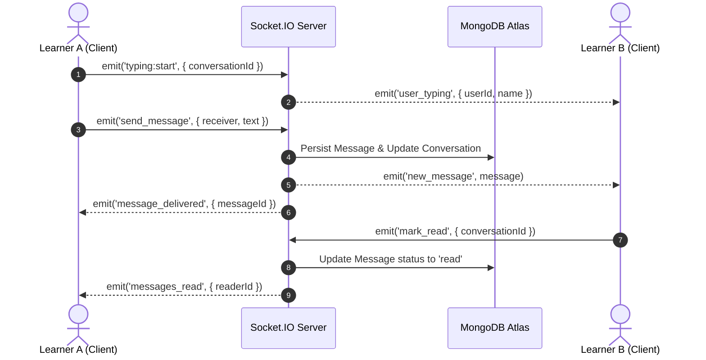
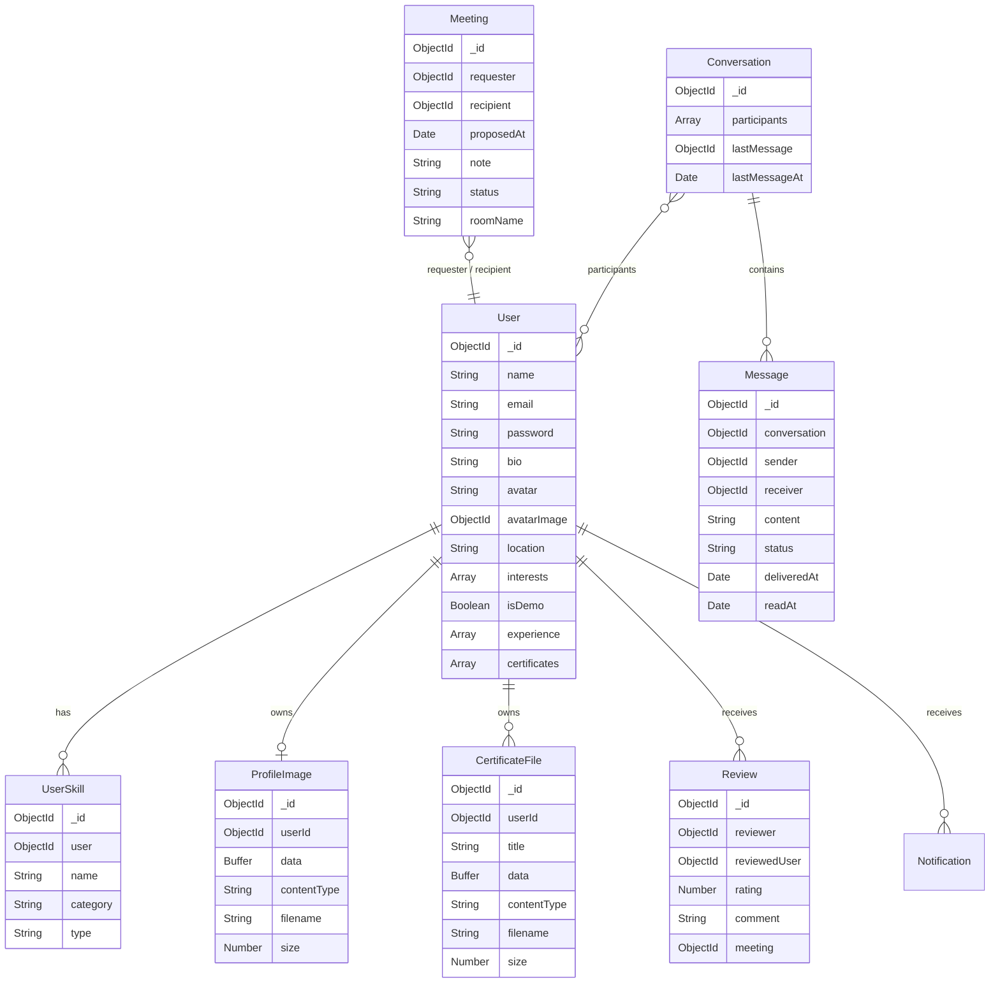

# Peerza — Peer Skill Exchange & Live Learning Platform
## Comprehensive Technical & Architecture Documentation

---

## 1. Project Overview & Core Philosophy

**Peerza** is a production-ready, full-stack **MERN (MongoDB, Express.js, React 18, Node.js)** platform engineered to foster collaborative, peer-to-peer knowledge exchange. Built on the principle of **"Trade what you know. Learn what you don't,"** Peerza eliminates the monetary barriers of traditional tutoring by creating an egalitarian skill-barter economy.

Learners on Peerza can:
- **Discover Compatible Learning Partners**: Find peers whose teaching skills match their learning ambitions and vice-versa.
- **Engage via Real-Time Communication**: Chat bi-directionally with persistent message history, typing indicators, multi-device presence, and read receipts powered by **Socket.IO**.
- **Conduct Video/Audio Learning Sessions**: Launch seamless, in-browser one-to-one video calls using the integrated **Jitsi Meet IFrame API**.
- **Build Credibility with Skill Evidence**: Upload certificates (PDF, JPG, PNG) and list verified professional experience stored natively in **MongoDB BSON Binary** storage (eliminating reliance on third-party cloud image hosts).
- **Exchange Trust through Reviews**: Submit ratings (1–5 stars) and detailed reviews following completed sessions to build community reputation.

---

## 2. Complete Technology Stack



### Detailed Stack Specifications

| Layer | Technology | Version | Purpose & Technical Highlight |
|---|---|---|---|
| **Frontend Framework** | **React** | `18.3.1` | Component-based reactive user interface with stateful hooks and context. |
| **Routing** | **React Router DOM** | `7.1.3` | Client-side Single Page Application (SPA) declarative routing. |
| **Build Tool & Bundler** | **Vite** | `6.4.5` | Lightning-fast Hot Module Replacement (HMR) and optimized rollup production bundling. |
| **Icons & Typography** | **Lucide React** | `0.473.0` | Comprehensive, lightweight, accessible icon library. Typography: *Manrope* (headings) & *DM Sans* (body). |
| **HTTP Client** | **Axios** | `1.7.9` | Promise-based HTTP client with request/response interceptors for automatic JWT attachment and 401 recovery. |
| **Real-Time Engine (Client)** | **socket.io-client** | `4.8.4` | WebSocket connection manager with fallback polling and reconnection logic. |
| **Backend Runtime** | **Node.js** | `>= 18.0.0` | High-performance asynchronous event-driven JavaScript server environment. |
| **Web Server Framework** | **Express.js** | `4.21.2` | RESTful API routing, error middleware, and CORS configuration. |
| **Real-Time Engine (Server)** | **Socket.IO** | `4.8.4` | Bidirectional real-time event broadcasting, presence management, and room routing. |
| **Database & ODM** | **MongoDB & Mongoose** | `8.9.5` | Document-oriented database with schema validation, indexes, and BSON binary buffers. |
| **Authentication & Hashing** | **JWT & bcryptjs** | `jsonwebtoken 9.0.2`, `bcryptjs 2.4.3` | Cryptographically signed tokens (7-day validity) and 12-round salted password hashing. |
| **Binary File Processing** | **Multer** | `2.5.0` | In-memory multipart buffer processing with MIME-type and magic-byte validation. |
| **Video Calling** | **Jitsi Meet API** | External IFrame API | In-app peer video/audio calling with deterministic room naming. |
| **Cloud Hosting** | **Vercel & Render** | Cloud Native | Frontend deployed on Vercel Global Edge CDN; Backend on Render persistent service. |

---

## 3. Comprehensive Page-by-Page Breakdown

### 1. Landing & Authentication Page (`/login` & `/register`)
The entry point of Peerza balances brand storytelling with streamlined authentication.



- **Hero & Value Proposition**: Displays the core tagline (*"Trade what you know. Learn what you don't"*), subheadings, and feature badges (*Complementary Matching, Real-Time Chat, Jitsi Video Calling*).
- **1-Click Demo Accounts**: Interactive quick-access buttons for testing personas:
  - **Maya Chen** (Design / Figma)
  - **Jordan Lee** (React / Technology)
  - **Amina Yusuf** (Illustration / Art)
- **Interactive Password Visibility Toggle**:
  - Hidden by default (`type="password"`).
  - Clicking the eye button toggles to visible (`type="text"`) with `EyeOff` / `Eye` icons.
  - Form safety: Configured with `type="button"` and `tabIndex={-1}` to prevent unintended form submission and preserve keyboard navigation.
- **Session Persistence**: Stores `peerza_token` and `peerza_user` in browser `localStorage`.
- **Validation**: Enforces email regex, name trimming, and minimum 8-character passwords with OWASP-safe error masking.

---

### 2. Discover Page (`/discover`)
The discovery hub where learners explore the community, filter skills, and initiate connections.

- **Category Filter Tabs**: One-click pills to filter learners by domain: `All people`, `Design`, `Technology`, `Art`, and `Business`.
- **Live Search & Keyboard Shortcut**:
  - Global search querying user names, skill names, and categories.
  - Pressing `Ctrl + K` (or `Cmd + K`) automatically focuses the search input from anywhere on the page.
- **Sorting Mechanisms**: Sort directory by *Best match*, *Highest rated*, *Most active*, or *Newest*.
- **Demo Accounts Filter**: A toggle button (`+ Include demo accounts` / `Real users only`) allowing users to isolate real registered members from demo seed accounts.
- **Learner Card Component**:
  - Squircle / circular color-coded avatar with initials fallback.
  - Live **Online Presence Dot** (green pulse indicator indicating active Socket.IO connection).
  - Name, category role, location, and star rating pill with review count.
  - Truncated bio with line clamping.
  - **CAN TEACH** tags (green pills) and **HOPING TO LEARN** tags (coral pills).
  - Bookmark / save toggle button.
  - Quick action: **"View profile"** modal trigger.
- **Bottom Callout Banner**: *"Your kind of people are out there. Build a profile with the skills you can share and want to learn. Edit your profile ->"* linking directly to profile editing.

---

### 3. Mutual Matches Page (`/matches`)
Peerza’s automated match-making engine that identifies complementary peer partnerships.

- **Algorithm Mechanics**:
  - Reads the authenticated user's `teach` and `learn` skills.
  - Identifies other learners whose `teach` list intersects with the user's `learn` list, AND whose `learn` list intersects with the user's `teach` list.
  - Computes a dynamic `score` based on total skill overlaps.
- **Match Card UI**:
  - Displays learner overview and match score pill.
  - Section 1: **"They can teach you"** (skills you want that they offer).
  - Section 2: **"You can teach them"** (skills you offer that they want).
  - One-click triggers: **Message** (opens direct chat), **Request a session** (opens scheduling modal), and **View profile**.
- **Empty State**: Guiding prompt encouraging the user to add both teach and learn skills if no mutual matches are found.

---

### 4. Real-Time Messenger (`/messages`)
A split-pane real-time messaging interface built for uninterrupted peer collaboration.



- **Conversations List (Left Pane)**:
  - Lists all active peer threads with user avatar, name, and online presence dot.
  - Preview of latest message text and relative timestamp.
  - Unread message badge counter.
- **Active Thread Panel (Right Pane)**:
  - Header: Partner name, online/offline status, and a **"Join Video Call"** button that automatically appears if an accepted session exists between the two learners!
  - Message Bubbles: Left-aligned incoming bubbles (light sage), right-aligned outgoing bubbles (forest green).
  - Status Indicators: Chronological timestamps and delivery status ticks (**Sent**, **Delivered**, **Read / Seen**).
  - **Typing Indicator**: Animated 3-dot pulse showing when the partner is typing.
  - Infinite scroll / pagination loading older messages.
  - Compose bar: Text input with Enter-to-send and Send button.

---

### 5. Learning Sessions & Video Meetings (`/sessions`)
The scheduling and video conferencing workflow for structured peer learning exchanges.

- **Session State Lifecycle**:
  $$\text{Pending} \xrightarrow{\text{Accept}} \text{Accepted} \xrightarrow{\text{Mark Done}} \text{Completed}$$
  $$\text{Pending} \xrightarrow{\text{Reject}} \text{Rejected}$$
- **Requesting a Session**: Modal form specifying recipient, proposed future date/time, and a learning topic note.
- **Session Cards**:
  - Partner avatar and name.
  - Proposed date and formatted time.
  - Custom note describing what the learners will teach/learn.
  - Status badge: `pending` (amber), `accepted` (green), `rejected` (coral), `completed` (slate blue).
- **In-App Video Calling Authorization**:
  - When a session is accepted, the server deterministically generates a unique room name:
    $$\text{roomName} = \text{"peerza-meet-" } + \text{meetingId} + \text{"-" } + \text{cryptoHash}$$
  - Unlocks the **"Join Video Call"** button for both participants.
  - Access control: Non-participants or unaccepted meetings are strictly blocked with `403 Forbidden`.
- **Session Completion & Reviews**:
  - Once completed, unlocks the **"Leave a review"** button.
  - Modal form allows submitting 1 to 5 stars with a written review note.

---

### 6. Fullscreen Jitsi Video Calling Overlay (`JitsiMeeting`)
An embedded, responsive video calling interface inside the web application.

- **IFrame Integration**: Loads `https://meet.jit.si/external_api.js` on demand.
- **In-Call Controls**:
  - **Mute / Unmute Microphone** (with live state indicator).
  - **Toggle Camera On / Off**.
  - **Toggle Fullscreen Mode**.
  - **Hang Up / Leave Call**: Disposes of the Jitsi session, cleans up DOM nodes, and triggers session refresh.
- **Session Banner**: Overlays meeting partner's name, avatar, and meeting note for full context during the call.

---

### 7. My Profile & Public Learner Profile (`/profile` & `/users/:id`)
Comprehensive learner portfolio showcasing credibility, verified evidence, skills, and peer reviews.

- **Profile Header**:
  - Contained avatar (`96px × 96px`, circular, with `object-fit: cover`).
  - Learner Name and verified evidence badge (`Certificate Provided` or `Experience Provided`).
  - Star rating summary pill (e.g. `★ 5.0 (4 reviews)`).
  - Location and personal bio.
  - "Edit Profile" action button (on personal view).
- **Skills Grid**: Two balanced cards showing "Skills I Can Teach" and "Skills I Want to Learn".
- **Professional Experience Section**:
  - Displays work background: Job Title, Company / Organization, Duration, and Description.
- **Certificates & Credentials Section**:
  - Displays uploaded credentials: Title, Issuing Authority, Associated Skill, and File metadata.
  - **"View Certificate"** button securely streams the file directly from MongoDB BSON storage in a new browser tab with inline headers.
- **Peer Reviews Section**:
  - List of historical reviews: Reviewer avatar, name, star rating, relative date, and written feedback.

---

### 8. Edit Profile & Credentials Page (`/profile/edit`)
A complete management dashboard for personal details, binary avatars, skills, work experience, and certificate documents.

- **Photo Upload Card**:
  - Real-time preview of selected image before uploading.
  - Max 2 MB enforcement with JPG, PNG, and WEBP support.
  - "Choose Photo", "Save Photo", and "Remove Photo" actions.
- **Personal Details Form**: Edit Name, Location, and Bio.
- **Skills Management**:
  - Add new skills with category selector (`Design`, `Technology`, `Art`, `Business`, `Other`) and type (`teach` / `learn`).
  - Inline edit and delete buttons for existing skills.
- **Professional Experience Manager**:
  - Add and remove work history items.
  - Automatically awards the **Experience Provided** verified badge.
- **Certificate Manager**:
  - Upload credential files (PDF, JPG, PNG) stored in MongoDB BSON binary.
  - Automatically awards the **Certificate Provided** verified badge.

---

## 4. Database Architecture & Data Models

All models are defined with Mongoose schemas in `server/src/models.js`:



### Native Binary Storage Architecture (No Cloudinary / S3)
To ensure **zero external cloud image dependencies** and zero recurring billing costs, Peerza utilizes **MongoDB BSON Binary Storage (`Buffer`)**:
1. **Profile Pictures (`ProfileImage`)**: Stored in a dedicated collection linked to `User`. Streamed via `GET /api/users/:id/avatar` with HTTP `ETag` and `Cache-Control` headers for maximum browser caching.
2. **Certificates (`CertificateFile`)**: Stored with MIME type and original filename. Streamed via `GET /api/profile/certificates/:id/file` with `Content-Disposition: inline` for seamless in-browser PDF/image rendering.
3. **Security Safeguards**: Multer memory storage enforces a strict **2 MB limit** and validates magic bytes (`FF D8 FF` for JPEG, `89 50 4E 47` for PNG, `52 49 46 46` for WEBP) to reject spoofed files.

---

## 5. REST API Endpoints Reference

### Authentication & Current User
| Method | Endpoint | Protection | Description |
|---|---|---|---|
| `POST` | `/api/auth/register` | Public | Register new user with bcrypt password hash. |
| `POST` | `/api/auth/login` | Public | Authenticate user & issue signed JWT. |
| `GET` | `/api/auth/me` | JWT | Get authenticated profile, rating, and review count. |

### Users & Directory
| Method | Endpoint | Protection | Description |
|---|---|---|---|
| `GET` | `/api/users` | JWT | Discover learners with search, category, and demo filtering. |
| `PUT` | `/api/users/profile` | JWT | Update name, bio, location, and interests. |
| `GET` | `/api/users/:id` | JWT | Get full public profile, skills, and reviews. |
| `GET` | `/api/users/:id/avatar` | Public | Stream binary profile image with ETag caching. |

### Profile, Binary Avatars & Credentials
| Method | Endpoint | Protection | Description |
|---|---|---|---|
| `POST` | `/api/profile/avatar` | JWT | Upload profile picture binary buffer (max 2 MB). |
| `DELETE` | `/api/profile/avatar` | JWT | Remove profile picture from database. |
| `POST` | `/api/profile/experience` | JWT | Add professional experience item. |
| `PUT` | `/api/profile/experience/:id` | JWT | Update existing experience item. |
| `DELETE` | `/api/profile/experience/:id` | JWT | Delete experience item. |
| `POST` | `/api/profile/certificates` | JWT | Upload certificate PDF/image to MongoDB BSON. |
| `DELETE` | `/api/profile/certificates/:id` | JWT | Delete certificate document & binary. |
| `GET` | `/api/profile/certificates/:id/file` | Public | Stream certificate document inline. |

### Skills & Matching
| Method | Endpoint | Protection | Description |
|---|---|---|---|
| `GET` | `/api/user-skills` | JWT | Fetch authenticated user's teach & learn skills. |
| `POST` | `/api/user-skills` | JWT | Add new teach or learn skill. |
| `PUT` | `/api/user-skills/:id` | JWT | Update skill name or category. |
| `DELETE` | `/api/user-skills/:id` | JWT | Delete skill. |
| `GET` | `/api/matches` | JWT | Calculate dynamic mutual skill matches. |

### Messaging & Real-Time
| Method | Endpoint | Protection | Description |
|---|---|---|---|
| `GET` | `/api/conversations` | JWT | Get active conversations with unread counters. |
| `GET` | `/api/conversations/:userId` | JWT | Get paginated message history with peer. |
| `PATCH` | `/api/conversations/:userId/read` | JWT | Mark all messages from sender as read. |
| `POST` | `/api/messages` | JWT | Send message via REST (broadcasts via Socket.IO). |

### Sessions & Video Calling
| Method | Endpoint | Protection | Description |
|---|---|---|---|
| `GET` | `/api/meetings` | JWT | Fetch incoming and outgoing learning sessions. |
| `POST` | `/api/meetings` | JWT | Request a session with another learner. |
| `PATCH` | `/api/meetings/:id/status` | JWT | Accept, reject, or mark session completed. |
| `GET` | `/api/meetings/:id/join` | JWT | Authorize participant & return persistent Jitsi room. |

### Reviews & Notifications
| Method | Endpoint | Protection | Description |
|---|---|---|---|
| `GET` | `/api/reviews/mine` | JWT | Fetch session IDs already reviewed by user. |
| `POST` | `/api/reviews` | JWT | Submit 1–5 star rating and comment for completed session. |
| `GET` | `/api/users/:id/reviews` | JWT | Fetch public reviews for a learner. |
| `GET` | `/api/notifications` | JWT | Get notifications and unread badge count. |
| `PATCH` | `/api/notifications/read-all` | JWT | Mark all notifications as read. |
| `PATCH` | `/api/notifications/:id/read` | JWT | Mark single notification as read. |

---

## 6. Security & Performance Model

1. **Authentication & Token Expiry**:
   - JWT tokens signed with HMAC SHA-256 (`JWT_SECRET`) with a 7-day expiration.
   - Handshake authentication on Socket.IO prevents unauthenticated socket connections.
2. **Password Security**:
   - 12-round salted hashing with `bcryptjs`.
   - OWASP-compliant error handling: Generic `"Email or password is incorrect."` masks account existence against enumeration attacks.
3. **MIME & Magic Byte Validation**:
   - File uploads are validated both by client MIME-types and server-side magic byte buffer inspection.
4. **CORS Isolation**:
   - Dynamic CORS origin checker allows only configured frontend origins (`CLIENT_URL`), `*.vercel.app` domains, and local development ports.
5. **Real-Time Presence Tracking**:
   - Map of `userId -> Set(socketId)` guarantees accurate online presence across multiple browser tabs without premature offline flickering.

---

## 7. Production Deployment Configuration

```text
┌──────────────────────────────────────┐     ┌──────────────────────────────────────┐
│           VERCEL (Frontend)          │     │           RENDER (Backend)           │
│  - React 18 + Vite SPA               │     │  - Node.js + Express + Socket.IO     │
│  - Root Directory: client            │     │  - Root Directory: server            │
│  - Rewrites via client/vercel.json   │────>│  - Persistent WebSocket Engine       │
│  - Env: VITE_API_URL                 │     │  - Env: MONGO_URI, JWT_SECRET, CORS  │
└──────────────────────────────────────┘     └──────────────────┬───────────────────┘
                                                                │
                                                                ▼
                                             ┌──────────────────────────────────────┐
                                             │         MONGODB ATLAS (Cloud)        │
                                             │  - M0 Free Cluster                   │
                                             │  - BSON Avatars & Certificates       │
                                             │  - High Availability & Security      │
                                             └──────────────────────────────────────┘
```

### Required Production Environment Variables

#### On Vercel (Frontend Project Settings):
| Variable | Value | Purpose |
|---|---|---|
| `VITE_API_URL` | `https://peerza-backend.onrender.com/api` | Directs all Axios and Socket.IO calls to Render. |
| `VITE_JITSI_DOMAIN` | `meet.jit.si` | Video calling domain. |

#### On Render (Backend Service Environment):
| Variable | Value | Purpose |
|---|---|---|
| `MONGO_URI` | `mongodb+srv://<user>:<password>@cluster0...mongodb.net/peerza` | MongoDB Atlas cloud connection string. |
| `JWT_SECRET` | Strong random secret | Signs and verifies user authentication tokens. |
| `CLIENT_URL` | `https://your-peerza-frontend.vercel.app` | Whitelists Vercel frontend origin in CORS. |
| `PORT` | `10000` | Render container listening port. |
| `JITSI_DOMAIN` | `meet.jit.si` | Video calling domain. |
